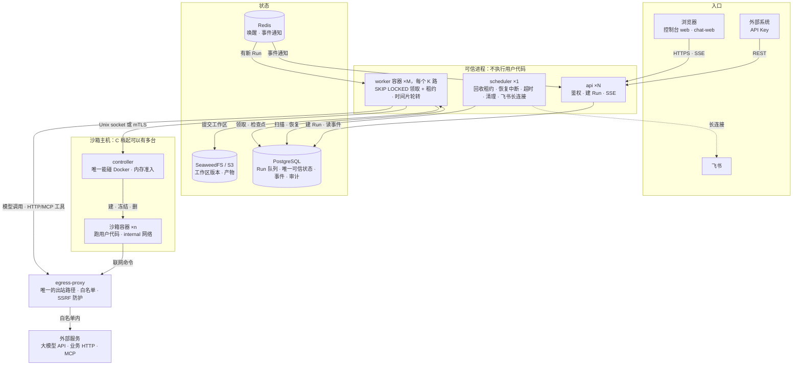
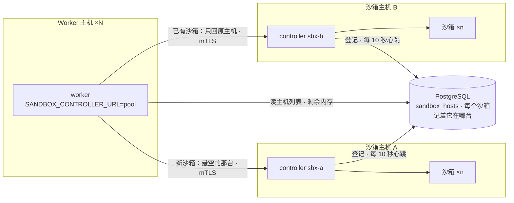

# 架构说明

> §28 要求仓库包含架构说明。这一份写的是**边界在哪、为什么在那里**，
> 而不是把目录树抄一遍。

## 进程

一个镜像（`apps/api/Dockerfile`），靠 `command` 跑出五个角色：

| 进程 | 职责 |
|---|---|
| `api` | HTTP 入口。不执行 Agent |
| `worker` | 执行 Run 的切片，持有租约 |
| `scheduler` | 唤醒等待中的 Run、回收失联的 Worker、清理 |
| `controller` | 沙箱容器的生命周期 |
| `egress-proxy` | **唯一的出站路径** |

前端两个：`apps/web`（控制台）与 `apps/chat-web`（终端用户聊天）。

## 一条消息怎么走

入口 → `api` 在 PostgreSQL 建 Run → Redis 叫醒一个 `worker` → `worker` 领取并调模型 →
模型要跑代码时，`worker` 请 `controller` 建沙箱 → 事件写回 PostgreSQL，`api` 经 SSE 推给
浏览器。模型调用、HTTP/MCP 工具、沙箱里的联网命令，出站都只经过 `egress-proxy`。
Redis 只管快：它不可用时 Worker 退回轮询、SSE 退回每 0.5 秒查库，状态不丢。

## 三条不能破的线

**一、出站只有一条路。** 平台内一切出站流量经过 `egress-proxy`。这条线由 ruff 的
TID251 在源码层强制（`packages/backend/tests/unit/outbound/test_client_ban.py` 跑
linter 并断言豁免清单），由 Docker 网络策略在网络层强制。

注意它的**边界**：TID251 管的是我们自己的源码 import 什么，**第三方 SDK 自己开 socket
不会触发它**。所以飞书适配器这类东西必须独立进程、在容器层面管出口。

**二、主体隔离在类型上表达。** `MemoryScope` 与 `AuditScope` **构造不出「所有主体」
或「所有工作空间」**。不是禁止，是写不出来——能被构造出来的最宽范围，就是有人终将
拿到的范围。

**三、Secret 从不以明文落库。** 信封加密：每个 Secret 一个 DEK，DEK 由部署侧 KEK
包装，数据库只有密文、包装后的 DEK 和 `key_id`。**KEK 不能和数据库放在一起**。

## 三种主体

| 主体 | 是谁 | 授权来自 |
|---|---|---|
| `User` | 平台成员 | `Membership` 的固定角色（§4.6） |
| `EndUser` | 用 Agent 的终端用户 | 企业签发的凭证 + 平台闸门，**不是工作空间成员** |
| `ServiceAccount` | 应用与自动化 | API Key，权限是主体权限与 Key scope 的交集 |

终端用户与平台成员是**两套身份体系**。飞书用户和 Web Chat 用户都是 `EndUser`，
`external_identities` 按 `(workspace, channel, external_user_id)` 唯一。

## Run 的执行

Run 是切片执行的：Worker 领租约、跑一轮、写检查点、让出。这让暂停、等待审批、等待
子 Agent、以及 Worker 崩溃后的恢复都是**同一个机制**，而不是四个特例。

子 Agent 只有一层（`depth <= 1`），权限是父权限与 `delegation_scope` 的**交集**，
预算按整棵树计。

## 示例 Agent

平台自带一个示例（§21 初始化向导的最后一步）。它在
`packages/backend/src/tiny_hermes/agents/domain/examples.py`，不是一个
`examples/*.json`——放在那里的样例会悄悄地跟 schema 脱节，而这里的 spec 走的是
每个已发布版本都要走的同一个 `AgentSpec`。

它读文件、写一个文件，不碰网络、不需要注册 HTTP 工具或 MCP 服务器。这不是为了
简单：向导跑到这一步时，部署里除了一个模型别名之外什么都还没有，一个需要别的东西
的示例根本创建不出来。

值得读的是它的 `completion.expected_artifacts`。模型说自己做完了不算数，那个文件
必须真的在（§12.2）——一个「说完了就算完了」的示例会把这个平台最要紧的一条教反。

创建走 `create_agent` → `replace_draft` → `publish` 三个既有方法，不另开写入路径：
绕过 `publish` 的检查往 `agent_versions` 里塞一行，就是第二扇没人看守的门。

## 容量与扩容

容量按「同一时刻正在执行的 Run 数」算，不按员工人数算。等审批、等人回复的 Run 不占
Worker，也不占沙箱。完整方案见 `docs/superpowers/plans/2026-09-29-enterprise-capacity.md`。

| 项 | 数字 | 依据 | 性质 |
|---|---|---|---|
| 一台 8 核 VM 同时执行 | 40 路 | 3 个 worker × 16 路，482 个 Run 全部完成，短消息排队 P95 0.04 秒 | 实测（[单机档验收](superpowers/verification/2026-09-30-tier-a-acceptance.md)） |
| 超载时 | 只排队 | 32 个长任务占满 32 条通道：短消息排队 P95 31.6 秒，0 失败 | 实测（同上） |
| 最先撞墙的 | PostgreSQL CPU | 40 路时峰值 224%，随并发涨得最快 | 实测（同上） |
| 6000 名员工的高峰并发 | 约 120–300 路 | 假设 2%–5% 的人同一时刻有任务在执行 | 估算 |

实测用的是确定性模型替身和 `printf` 工具，环境是 8 核 / 7.8 GiB 的 OrbStack VM，
不是 §24.1 的参考机。真实模型每路要多少 CPU、真实工具的沙箱要多少内存，都没测过。

`worker` 可以放在多台机器上（B 档，[验收](superpowers/verification/2026-10-21-tier-b-acceptance.md)），
沙箱主机也可以有多台（C 档，[验收](superpowers/verification/2026-10-24-tier-c-acceptance.md)）：

- 新沙箱放到剩余内存最多的主机；每台按自己的预算准入，满了换下一台。
- 已有沙箱的 Run 只回原主机：冻结的沙箱只能在原地解冻，原主机连不上就等，不在别处另建。
- 主机坏了要运维 `retire` 确认，它上面的 Run 才会到别的主机冷恢复（工作区按版本存在对象存储里，
  冷恢复可以落在任何一台上）。
- 每台主机的沙箱地址池互不重叠，出站代理按地址认 Run 才不会认错。

## 更细的地方

- 产品事实来源：`docs/superpowers/specs/2026-08-09-tiny-hermes-product-design.md`
- 每个阶段的验收记录：`docs/superpowers/verification/`，每份都有
  「这一遍没能证明什么」
- 开发环境与坑：`docs/development.md`；运维：`docs/operations.md`
